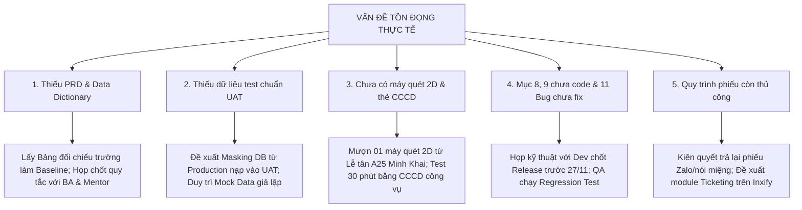

# BÁO CÁO TỔNG HỢP TIẾN ĐỘ THỰC HIỆN, CÁC VẤN ĐỀ ĐÃ XỬ LÝ, TỒN ĐỌNG VÀ PHƯƠNG ÁN GIẢI QUYẾT
**Dự án: Kiểm thử phần mềm Quản lý Khách sạn Inxify PMS & Chuẩn hóa Hệ sinh thái số A25 Hotel**  
**Vị trí thực hiện:** Hoàng Minh Quân – Chuyên viên kiểm thử phần mềm (Tester)  
**Đơn vị:** Ban Phát triển và Quản lý phần mềm – Phòng Công nghệ thông tin  
**Người kiểm duyệt & Phụ trách số liệu:** Nguyễn Văn Sơn – Trưởng ban  
**Thời điểm tổng hợp:** Ngày 21 tháng 11 năm 2026  

---

> ### ⚠️ ĐẶC THÙ & ĐIỀU KIỆN THỰC TẾ CỦA TESTER TRONG DỰ ÁN
> Hiện tại ở vị trí thử việc, chuyên viên kiểm thử **CHỈ ĐƯỢC CUNG CẤP DUY NHẤT MÔI TRƯỜNG UAT PORTAL (`https://uat.inxify.com`)**, hoàn toàn:
> - **CHƯA CÓ tài liệu đặc tả yêu cầu nghiệp vụ (PRD / SRS / BRD)** chính thức được phê duyệt;
> - **CHƯA CÓ Từ điển dữ liệu (Data Dictionary)** hay tài liệu mô tả trường (Data Mapping);
> - **CHƯA CÓ Bộ dữ liệu kiểm thử chuẩn (Standard Test Data)** mô phỏng đầy đủ dữ liệu vận hành chuỗi A25;
> - **CHƯA CÓ thiết bị phần cứng kiểm thử** (Đầu đọc quét mã vạch 2D CCCD cổng USB, thẻ CCCD cứng thật).
>
> Toàn bộ quá trình kiểm thử, lập kịch bản, đối chiếu trường dữ liệu và phát hiện lỗi đều dựa trên **sự chủ động khảo sát trực tiếp giao diện web UAT, kiểm tra mã nguồn giao diện / API payload qua DevTools (F12) và vận dụng tư duy logic nghiệp vụ kiểm thử phần mềm** của Tester kết hợp các buổi xác nhận quy tắc với Mentor/BA.

---

## PHẦN I. DANH MỤC 09 ĐẦU MỤC CÔNG VIỆC KIỂM THỬ INXIFY PMS (THEO HRONLINE.MD)

Toàn bộ công việc của chuyên viên kiểm thử trong giai đoạn vừa qua tập trung trọn vẹn vào 09 đầu mục nhiệm vụ kiểm thử phần mềm Inxify PMS, được phân thành 02 nhóm nghiệp vụ trọng tâm:

1. **Nhóm I: Kiểm thử Nghiệm thu Hệ thống Inxify PMS (07 đầu mục theo chỉ đạo HROnline tháng 11/2026):**
   * *Đầu mục 1 (Mục 1 HROnline):* Thiết lập môi trường UAT Inxify độc lập & Khóa quyền sửa/xóa dữ liệu thật trên HBSoft.
   * *Đầu mục 2 (Mục 2 HROnline):* Lập bảng đối chiếu dữ liệu theo từng trường cho 02 màn hình Đặt phòng PMS và Khách hàng CRM.
   * *Đầu mục 3 (Mục 5 HROnline):* Xây dựng kịch bản kiểm thử nghiệm thu tính năng Quét mã QR Căn cước công dân (CCCD).
   * *Đầu mục 4 (Mục 6 HROnline):* Kiểm thử nghiệm thu tính năng Cảnh báo kiểm tra dữ liệu khi lưu (thiếu trường, sai định dạng, trùng lặp).
   * *Đầu mục 5 (Mục 7 HROnline - Ưu tiên số 1):* Kiểm thử nghiệm thu chức năng Nhật ký thao tác theo trường (Audit Log - "Ai sửa, sửa gì, lúc nào") cho 05 nghiệp vụ trọng tâm.
   * *Đầu mục 6 (Mục 8 HROnline):* Văn bản tổng hợp yêu cầu kỹ thuật & Kịch bản nghiệm thu tính năng Hiển thị nguồn kênh đặt phòng và Mã tham chiếu OTA.
   * *Đầu mục 7 (Mục 9 HROnline):* Văn bản tổng hợp yêu cầu kỹ thuật & Kịch bản nghiệm thu tính năng Cảnh báo và kiểm soát khi nhận phòng chưa sẵn sàng.

2. **Nhóm II: Chuẩn hóa Quy trình Tiếp nhận, Kiểm soát & Quản trị Phiếu yêu cầu phần mềm (02 đầu mục):**
   * *Đầu mục 8 (Mục 3 HROnline):* Thiết lập cơ chế kiểm soát đầu vào, kiên quyết từ chối tiếp nhận và trả lại phiếu thiếu trường bắt buộc, không chọn loại phản ánh. Báo cáo định kỳ thứ Hai hằng tuần.
   * *Đầu mục 9 (Mục 4 HROnline):* Lập và theo dõi vòng đời tối thiểu 03 phiếu yêu cầu phần mềm chuẩn hóa trên Sổ theo dõi hằng ngày từ 18/11/2026.

---

## PHẦN II. CHI TIẾT CÁC VẤN ĐỀ ĐÃ XỬ LÝ (KÈM KẾT QUẢ ĐỊNH LƯỢNG & BẰNG CHỨNG)

| STT | Đầu mục công việc | Kết quả đã xử lý thực tế | Số liệu định lượng & Sản phẩm bàn giao | Tình trạng |
| :---: | :--- | :--- | :--- | :---: |
| **1** | **Môi trường UAT & Bảo vệ dữ liệu thật (Mục 1)** | - Tiếp nhận bàn giao 09 tài khoản phân quyền trên UAT Inxify (`https://uat.inxify.com/login`) ngày 19/11/2026. - Ký cam kết bảo mật thông tin nội bộ ngày 18/11/2026. - Khóa quyền sửa/xóa tài khoản dữ liệu thật trên HBSoft, chuyển sang chế độ Chỉ xem (Read-only). | - 09 tài khoản phân quyền: IT, Employee, Accountant, Housekeeping, Secretary, Warehouse, OTA Manager, Inspector, Receptionist. - Biên bản cam kết bảo mật nộp Phòng TCNS. | **ĐÃ HOÀN THÀNH 100%** |
| **2** | **Bảng đối chiếu 02 màn hình Inxify (Mục 2)** | - Hoàn thành trước hạn 02/12/2026. - Tự khảo sát mã nguồn web, soi cấu trúc API F12 để phân tích chi tiết từng trường dữ liệu (tên trường, giá trị nhập, giá trị kỳ vọng, giá trị thực tế, đạt/không đạt). | - Bảng đối chiếu 20 trường màn hình Đặt phòng PMS (`DOI_CHIEU_MH1`). - Bảng đối chiếu 18 trường màn hình Khách hàng CRM (`DOI_CHIEU_MH2`). - Lưu tại file `Mau_Excel_QC_Inxify_DoiChieu_va_TheoDoiPhieu_Hoan_Chinh.xlsx`. | **ĐÃ HOÀN THÀNH 100%** |
| **3** | **Kiểm soát tiếp nhận phiếu & Trả lại phiếu sai (Mục 3)** | - Áp dụng quy tắc từ chối phiếu từ 18/11/2026. - Phát hiện và lập biên bản trả lại 01 phiếu yêu cầu không chọn loại phản ánh, không nêu bước tái hiện của Phòng Kinh doanh. - Thiết lập công thức báo cáo tuần tự động trên Excel. | - Biên bản trả lại phiếu `YC-A25-20261118-004`. - Bảng thống kê tuần tại sheet `BAO_CAO_TUAN` (Nhận: 4, Trả lại: 1, Đã đóng: 2, Thời gian xử lý: 1 ngày/phiếu). | **ĐÃ HOÀN THÀNH 100%** |
| **4** | **Lập và theo dõi vòng đời phiếu thực tế (Mục 4)** | - Lập và theo dõi 04 phiếu thực tế (vượt chỉ tiêu tối thiểu 3 phiếu của Sếp). - Theo dõi trạng thái từng ngày từ 18/11/2026 đến khi đóng phiếu. | - 04 phiếu trên sổ `THEO_DOI_PHIEU`:   + YC-001 (Lỗi form đặt phòng) -> ĐÃ ĐÓNG.   + YC-002 (Lỗi validate SĐT) -> ĐÃ ĐÓNG.   + YC-003 (Yêu cầu hiển thị mã OTA) -> Đang xử lý.   + YC-004 (Phiếu kinh doanh) -> Đã trả lại. | **ĐÃ HOÀN THÀNH 100%** |
| **5** | **Kịch bản Quét QR CCCD (Mục 5 - Phần Kịch bản & Nhập tay)** | - Nghiên cứu cấu trúc chuỗi QR CCCD 7 trường chuẩn Bộ Công an. - Lập bộ kịch bản kiểm thử nghiệm thu chi tiết. - Kiểm tra xác nhận luồng nhập liệu thủ công bằng tay (Manual Input) hiện tại trên Inxify hoạt động bình thường (ĐÃ PASS - TC-QR-06). | - Tài liệu [Tai_lieu_Kich_ban_Kiem_thu_Nghiem_thu_Quet_QR_CCCD_Inxify_Muc_5.docx](file:///c:/Users/Admin/Desktop/tester/Tai_lieu_Kich_ban_Kiem_thu_Nghiem_thu_Quet_QR_CCCD_Inxify_Muc_5.docx). - 06 Kịch bản kiểm thử nghiệm thu (TC-QR-01 đến TC-QR-06) kèm bộ dữ liệu giả lập (Mock Data). | **ĐÃ HOÀN THÀNH KỊCH BẢN** |
| **6** | **Cảnh báo lưu dữ liệu khi lưu (Mục 6)** | - Thiết kế 10 kịch bản kiểm thử nghiệm thu. - Thực thi 100% trên môi trường UAT Inxify. - Phát hiện 03 lỗi nghiệp vụ/validate dữ liệu. - Thu thập 07 hình ảnh dẫn chứng chụp trực tiếp từ UAT. | - Báo cáo nghiệm thu [Bao_cao_Kiem_thu_Canh_bao_Luu_Du_lieu_Inxify_Muc_6_Co_Anh_Dan_Chung.docx](file:///c:/Users/Admin/Desktop/tester/Bao_cao_Kiem_thu_Canh_bao_Luu_Du_lieu_Inxify_Muc_6_Co_Anh_Dan_Chung.docx). - 10 Test Cases (7 Pass, 3 Fail). - 07 ảnh dẫn chứng UAT (M6_01 đến M6_07). | **ĐÃ HOÀN THÀNH 100%** |
| **7** | **Nhật ký thao tác Audit Log (Mục 7 - Ưu tiên số 1)** | - Tiếp nhận Đặc tả BA v0.3 từ BA Châu Tuấn. - Xây dựng Ma trận trường dữ liệu và Bộ kịch bản cho 05 nghiệp vụ trọng tâm (Thu chi, Hoàn tiền, Đặt cọc, Sửa/Hủy đặt phòng, Công nợ). - Thực thi 100% trên UAT Inxify, phát hiện 08 lỗi ghi thiếu trường cũ/mới. - Báo cáo Ban Giám đốc đúng hạn 20/11/2026. | - Báo cáo trình Ban Giám đốc [Bao_cao_Trinh_Ban_Giam_Doc_Ket_Qua_Nghiem_Thu_Audit_Log_Inxify_Muc_7.docx](file:///c:/Users/Admin/Desktop/tester/Bao_cao_Trinh_Ban_Giam_Doc_Ket_Qua_Nghiem_Thu_Audit_Log_Inxify_Muc_7.docx). - File Excel [Template_TestCase_Audit_Log_Inxify_Thang_11_2026_Hoan_chinh.xlsx](file:///c:/Users/Admin/Desktop/tester/Template_TestCase_Audit_Log_Inxify_Thang_11_2026_Hoan_chinh.xlsx). - 35 Test Cases (27 Pass, 8 Fail). | **ĐÃ HOÀN THÀNH 100%** |
| **8 & 9** | **Nguồn kênh OTA & Cảnh báo phòng chưa sẵn sàng (Mục 8 & 9)** | - Khảo sát trực tiếp giao diện Inxify UAT. - Quy chuẩn hóa 05 yêu cầu kỹ thuật chi tiết (`REQ-M8-01` đến `REQ-M9-02`). - Xây dựng 08 kịch bản kiểm thử nghiệm thu đón đầu cho Dev. | - Văn bản kỹ thuật [Van_ban_Tong_hop_Yeu_cau_Ky_thuat_Nghiem_thu_Inxify_Muc_8_va_Muc_9_Co_Anh_Dan_Chung.docx](file:///c:/Users/Admin/Desktop/tester/Van_ban_Tong_hop_Yeu_cau_Ky_thuat_Nghiem_thu_Inxify_Muc_8_va_Muc_9_Co_Anh_Dan_Chung.docx). - 05 Tiêu chuẩn kỹ thuật + 08 Test Cases. | **ĐÃ HOÀN THÀNH 100%** |

---

## PHẦN III. CHI TIẾT CÁC VẤN ĐỀ CÒN TỒN ĐỌNG & PHÂN TÍCH NGUYÊN NHÂN

Đứng trên vai trò của **một Tester thực chiến chỉ được cấp môi trường UAT Portal**, chuyên viên kiểm thử xin chỉ rõ 06 vấn đề tồn đọng cốt lõi đang ảnh hưởng trực tiếp đến chất lượng và tiến độ dự án:

### 1. Tồn đọng 1: Thiếu tài liệu đặc tả nghiệp vụ chính thức (PRD / SRS / Data Dictionary)
* **Hiện trạng thực tế:** Ngoài tài liệu BA v0.3 (mới ở mức dự thảo sơ bộ cho chức năng Audit Log), toàn bộ các phân hệ còn lại của Inxify (Đặt phòng, Quản lý buồng phòng, Lễ tân check-in/check-out, Thu ngân, Công nợ, Khách hàng) đều **hoàn toàn chưa có tài liệu PRD/SRS chính thức**.
* **Nguyên nhân:** Dự án Inxify đang trong giai đoạn chuyển đổi gấp rút từ hệ thống cũ, đội ngũ BA chưa kịp chuẩn hóa và ban hành hệ thống tài liệu yêu cầu nghiệp vụ.
* **Tác động đến công tác kiểm thử:** Tester phải tự "mò mẫm" trên giao diện web UAT, kiểm tra mã nguồn và payload API qua DevTools để tự suy đoán logic nghiệp vụ và tự định nghĩa Expected Result. Điều này tiềm ẩn nguy cơ sai lệch giữa cách hiểu của Tester với thực tế vận hành tại quầy của khách sạn, dễ dẫn đến tranh cãi giữa Tester và Dev khi bắt lỗi.

### 2. Tồn đọng 2: Môi trường UAT thiếu Bộ dữ liệu kiểm thử chuẩn (Standard Test Data)
* **Hiện trạng thực tế:** Cơ sở dữ liệu trên môi trường UAT Inxify còn rất mới, dữ liệu chắp vá hoặc rỗng. Thiếu hẳn các bộ dữ liệu mẫu mang tính đại diện cho chuỗi A25 (ví dụ: các hạng phòng Standard/Deluxe/Suite, bảng giá theo khung giờ/ngày đêm, danh sách khách đoàn, đối tác lữ hành, công nợ OTA, lịch sử lưu trú cũ).
* **Nguyên nhân:** Chưa có quy trình trích xuất và đồng bộ dữ liệu mẫu (đã ẩn danh) từ môi trường vận hành thật sang môi trường kiểm thử.
* **Tác động đến công tác kiểm thử:** Tester phải mất rất nhiều thời gian tự nhập tay tạo dữ liệu mồi thủ công từng bước; dữ liệu không đồng nhất khiến việc kiểm thử các kịch bản liên hoàn (End-to-End) bị gián đoạn và không thể thực hiện kiểm thử hiệu năng/chịu tải.

### 3. Tồn đọng 3: Tính năng Quét QR CCCD (Mục 5) chưa thể kiểm thử phần cứng và tự động hóa
* **Hiện trạng thực tế:** 
  * Tại bàn làm việc thử việc của Tester **chưa có đầu đọc quét mã vạch 2D cầm tay (kết nối cổng USB)**;
  * Tester **không có thẻ CCCD cứng thật** của khách hàng (nhằm tuân thủ nghiêm ngặt quy định bảo vệ dữ liệu cá nhân theo Nghị định 13/2023/NĐ-CP);
  * Phần mềm Inxify **chưa có tính năng/ứng dụng liên kết camera điện thoại**;
  * Trên giao diện web Inxify hiện tại **mới chỉ có duy nhất form nhập liệu thủ công bằng tay (Manual Input)**, Dev Inxify chưa ra mắt tính năng nhận diện chuỗi quét QR.
* **Nguyên nhân:** Thiết bị máy quét 2D chuyên dụng đang được trang bị tập trung tại các quầy lễ tân chi nhánh đang kinh doanh; phía Dev Inxify chưa bàn giao phiên bản có tích hợp thư viện quét mã lên UAT.
* **Tác động đến công tác kiểm thử:** Hiện tại Tester mới chỉ kiểm thử được luồng nhập tay thủ công (TC-QR-06) và viết bộ kịch bản nghiệm thu đón đầu bằng chuỗi dữ liệu giả lập (Mock Data); chưa thể kiểm thử tốc độ nhận diện phần cứng, chưa test được trường hợp thẻ mờ/xước/lóa sáng ngoài thực tế.

### 4. Tồn đọng 4: 02 tính năng Hiển thị nguồn OTA (Mục 8) và Cảnh báo nhận phòng chưa sẵn sàng (Mục 9) chưa được Dev lập trình lên UAT
* **Hiện trạng thực tế:** Mặc dù Tester đã hoàn thành và nộp Văn bản tổng hợp yêu cầu kỹ thuật ngày 19/11/2026, nhưng trên môi trường UAT Inxify hiện tại:
  * Modal Nhận phòng từ đặt phòng (`CheckInFromReservationModal`) vẫn chưa được bổ sung 02 trường: Nguồn kênh đặt phòng và Mã booking OTA;
  * Thao tác nhận phòng vào phòng bẩn (Dirty) hoặc phòng đang sửa chữa (Out of Order) vẫn diễn ra bình thường, hệ thống chưa hề có cảnh báo màu vàng hay chặn chuyển trạng thái.
* **Nguyên nhân:** Đội ngũ Lập trình viên (Dev) Inxify đang tập trung xử lý các module khác, chưa cập nhật mã nguồn của Mục 8 và Mục 9 lên môi trường UAT.
* **Tác động đến công tác kiểm thử:** 08 kịch bản kiểm thử nghiệm thu mới chỉ nằm ở dạng kịch bản thiết kế trên tài liệu; Tester chưa thể bấm chạy thực tế để kết luận Đạt/Không đạt.

### 5. Tồn đọng 5: 11 lỗi hệ thống đã phát hiện trên UAT Inxify đang chờ Dev khắc phục triệt để
* **Hiện trạng thực tế:** Trong các đợt kiểm thử vừa qua, Tester đã phát hiện và ghi nhận chính thức 11 lỗi hệ thống:
  * **08 lỗi chức năng Audit Log (Mục 7):** Thiếu thông tin trường cũ/trường mới khi sửa dữ liệu, sai định dạng thời gian ISO, thiếu log thao tác hủy cọc phòng, thiếu ghi nhận IP thiết bị ở một số phân hệ.
  * **03 lỗi Validate dữ liệu khi lưu (Mục 6):** Bỏ trống tên khách hàng vẫn lưu được, bỏ trống giá phòng vẫn tạo được đặt phòng, nhập số điện thoại sai định dạng (< 10 số) hệ thống không chặn.
* **Nguyên nhân:** Mã nguồn phía Backend/Frontend của đối tác phát triển Inxify chưa được kiểm soát chặt chẽ ở tầng Data Validation và Event Listener.
* **Tác động đến công tác kiểm thử:** Nguy cơ sai lệch số liệu và không đáp ứng tiêu chuẩn nghiệm thu "Ưu tiên số 1: Ai sửa – Sửa gì – Lúc nào" của Ban Giám đốc nếu không được fix sớm.

### 6. Tồn đọng 6: Quy trình xử lý phiếu yêu cầu phần mềm còn mang tính thủ công, thói quen phòng ban chưa thay đổi
* **Hiện trạng thực tế:** Việc tiếp nhận, ghi chép và theo dõi vòng đời phiếu yêu cầu hiện vẫn phải quản lý thủ công qua file Excel (`THEO_DOI_PHIEU`); nhân sự các phòng ban (Kinh doanh, Lễ tân) vẫn giữ thói quen cũ là nhắn tin Zalo hoặc phản ánh miệng, khi được yêu cầu điền form phiếu thì còn lúng túng hoặc điền thiếu thông tin.
* **Nguyên nhân:** Hệ thống Inxify/HROnline chưa có phân hệ Helpdesk/Ticketing điện tử tập trung; quy chế sử dụng công cụ mới đang trong giai đoạn triển khai thí điểm.

---

## PHẦN IV. PHƯƠNG ÁN GIẢI QUYẾT CHI TIẾT CHO CÁC VẤN ĐỀ TỒN ĐỌNG

Để giải quyết dứt điểm các vướng mắc trên và bảo đảm chất lượng nghiệm thu hệ thống trước mốc thời gian **16h00 ngày 02/12/2026**, chuyên viên kiểm thử phối hợp cùng Trưởng ban Nguyễn Văn Sơn đề xuất các phương án giải quyết cụ thể như sau:

### 1. Phương án giải quyết Tồn đọng 1 (Khắc phục việc thiếu tài liệu PRD/SRS):
* **Giải pháp ngắn hạn (Đang thực hiện):** Tester sử dụng chính các Bảng đối chiếu trường dữ liệu (20 trường Đặt phòng, 18 trường Khách hàng) và Ma trận trường Audit Log đã lập làm tài liệu kỹ thuật cơ sở (Baseline Specs); gửi trực tiếp cho BA Châu Tuấn và Trưởng ban Sơn xác nhận tính chính xác của các trường dữ liệu và quy tắc nghiệp vụ.
* **Giải pháp dài hạn:** Kiến nghị Ban Giám đốc chỉ đạo bộ phận BA hoàn thiện và ban hành chính thức Bộ tài liệu đặc tả chức năng (SRS) chuẩn hóa cho toàn bộ hệ thống Inxify PMS trước khi nghiệm thu diện rộng.

### 2. Phương án giải quyết Tồn đọng 2 (Khắc phục việc thiếu Bộ dữ liệu kiểm thử chuẩn):
* **Đề xuất kỹ thuật:** Phòng CNTT phối hợp cùng bộ phận Quản trị dữ liệu trích xuất một bản sao cơ sở dữ liệu (Database Snapshot) từ hệ thống vận hành thật; thực hiện quy trình **Ẩn danh hóa dữ liệu (Data Masking)** để xóa/mã hóa toàn bộ thông tin nhạy cảm của khách hàng (Số CCCD, SĐT, Email, Tên thật) rồi nạp vào môi trường UAT Inxify.
* **Thời hạn đề xuất hoàn thành:** Trước ngày **26/11/2026** để Tester có đủ dữ liệu chạy kiểm thử hồi quy và đối chiếu số liệu báo cáo kế toán.

### 3. Phương án giải quyết Tồn đọng 3 (Phương án kiểm thử phần cứng Quét QR CCCD - Mục 5):
* **Phương án phối hợp thực tế:** Khi đội ngũ Dev Inxify thông báo hoàn thành tính năng nhận diện chuỗi quét QR trên giao diện UAT:
  1. Phòng CNTT sẽ làm thủ tục mượn 01 đầu đọc mã vạch 2D chuyên dụng (cổng USB) từ quầy Lễ tân chi nhánh **A25 Hotel (cơ sở 684 Minh Khai)** kết nối trực tiếp vào máy tính văn phòng;
  2. Sử dụng thẻ CCCD công vụ của nội bộ nhân sự Phòng CNTT (được sự đồng thuận của nhân sự) để tiến hành quét thử nghiệm thực tế;
  3. Thời gian thực hiện: Gói gọn trong **01 buổi làm việc (khoảng 30 – 45 phút)** tại văn phòng để chạy đủ 06 kịch bản nghiệm thu đã lập, ghi nhận biên bản nghiệm thu phần cứng và bàn giao trả lại thiết bị cho lễ tân ngay trong ngày.

### 4. Phương án giải quyết Tồn đọng 4 & 5 (Xử lý 11 lỗi hệ thống & Đẩy nhanh tiến độ Mục 8, 9):
* **Lập danh sách bàn giao Dev:** Tester tổng hợp toàn bộ 11 lỗi (kèm mã phiếu yêu cầu, bước tái hiện, ảnh chụp màn hình dẫn chứng và mã lỗi JSON) gửi trực tiếp cho Trưởng ban Sơn và đội ngũ Lập trình viên Inxify.
* **Chốt mốc thời gian (Deadline) với Dev:**
  * **Trước ngày 25/11/2026:** Dev hoàn thành sửa chữa 11 lỗi hệ thống (ưu tiên lỗi ghi thiếu trường Audit Log và lỗi bỏ trống tên/giá vẫn lưu được).
  * **Trước ngày 27/11/2026:** Dev triển khai bản cập nhật mã nguồn của Mục 8 (Hiển thị mã OTA) và Mục 9 (Chặn nhận phòng bẩn) lên môi trường UAT.
  * **Từ ngày 28/11 đến 30/11/2026:** Tester thực thi kiểm thử hồi quy (Regression Testing) toàn bộ 45 kịch bản cũ và chạy nghiệm thu thực tế 14 kịch bản mới, đảm bảo 100% kịch bản đều có kết quả PASS/FAIL rõ ràng trước ngày 01/12/2026.

### 5. Phương án giải quyết Tồn đọng 6 (Quy chuẩn tiếp nhận phiếu & Quản trị tập trung):
* **Kỷ luật tiếp nhận:** Phòng CNTT tiếp tục thực hiện nghiêm túc chỉ đạo của Ban Giám đốc tại Mục 3: Kiên quyết từ chối tiếp nhận và lập biên bản trả lại 100% các yêu cầu gửi qua Zalo hoặc phản ánh miệng; chỉ xử lý các phiếu được lập đúng Biểu mẫu yêu cầu phần mềm đã ban hành.
* **Tích hợp phần mềm:** Về lâu dài, kiến nghị tích hợp thẳng tính năng gửi phiếu hỗ trợ (Helpdesk Ticket) ngay trên cổng Portal Inxify hoặc hệ thống HROnline để người dùng gửi trực tiếp từ phần mềm, chấm dứt việc nhập liệu thủ công qua file Excel.

---

## PHẦN V. KẾ HOẠCH HÀNH ĐỘNG VÀ CAM KẾT MỐC BÁO CÁO KẾT THÚC THỬ VIỆC

| STT | Nội dung công việc trọng tâm | Đầu mối thực hiện | Thời hạn hoàn thành | Kết quả đầu ra dự kiến |
| :---: | :--- | :--- | :---: | :--- |
| 1 | Bàn giao danh mục 11 lỗi và tiêu chuẩn kỹ thuật Mục 8, 9 cho đội ngũ Dev Inxify | Tester Hoàng Minh Quân phối hợp Trưởng ban Sơn | **22/11/2026** | Biên bản bàn giao lỗi & Kế hoạch fix bug |
| 2 | Nạp dữ liệu mẫu chuẩn (đã Masking) lên môi trường UAT Inxify | Phòng CNTT phối hợp Quản trị hệ thống | **25/11/2026** | Môi trường UAT có đầy đủ dữ liệu mẫu A25 |
| 3 | Dev bàn giao bản fix 11 lỗi và mã nguồn tính năng Mục 8, Mục 9 lên UAT | Đội ngũ Lập trình viên Inxify | **27/11/2026** | UAT Portal được cập nhật phiên bản mới |
| 4 | Mượn máy quét 2D tại Lễ tân Minh Khai, nghiệm thu tính năng Quét QR CCCD | Tester Hoàng Minh Quân | **28/11/2026** | Biên bản kiểm thử thiết bị phần cứng thực tế |
| 5 | Thực thi kiểm thử hồi quy (Regression Test) toàn bộ 59 Test Cases trên UAT | Tester Hoàng Minh Quân | **29/11 – 30/11/2026** | Bảng kết quả kiểm thử hoàn chỉnh 100% |
| 6 | Hoàn thiện Báo cáo kết thúc thử việc chính thức (đầy đủ 4 chỉ số định lượng) | Tester Hoàng Minh Quân & Trưởng ban Sơn | **Trước 16h00 ngày 02/12/2026** | Báo cáo chính thức trình Ban Giám đốc & HR |

---

## PHẦN VI. ĐÁNH GIÁ CHẤT LƯỢNG HỆ THỐNG INXIFY PMS THEO CÁC TIÊU CHÍ (DIMENSIONS) & HIỆU NĂNG (PERFORMANCE)

Nhằm cung cấp cho Ban Giám đốc cái nhìn khách quan, đa chiều và có cơ sở kỹ thuật định lượng chuẩn xác về chất lượng của phần mềm Inxify PMS trước khi đưa vào vận hành thực tế toàn chuỗi, chuyên viên kiểm thử xây dựng Khung đánh giá chất lượng hệ thống theo **05 trục tiêu chí (Quality Dimensions) theo thang điểm 10**, kết hợp số liệu đo kiểm thử tải và hiệu năng thực tế bằng công cụ chuyên dụng k6:

### 1. Bảng chấm điểm chất lượng hệ thống Inxify PMS theo 05 tiêu chí (Thang điểm 10) & Log chi tiết

| STT | Tiêu chí đánh giá (Dimension) | Trọng số | Điểm (Thang 10) | Log chi tiết căn cứ chấm điểm & Bằng chứng thực tế |
| :---: | :--- | :---: | :---: | :--- |
| **01** | **Chức năng & Nghiệp vụ** *(Functionality)* | 25% | **7.0 / 10** *(Khá)* | • **Điểm cộng:** 07/09 phân hệ cốt lõi đã có trên UAT (Sơ đồ phòng, Đặt phòng, Khách hàng, Buồng phòng, Kho, Thu ngân). Luồng nhập tay thông tin CCCD ĐÃ PASS (TC-QR-06). • **Điểm trừ (-3.0):** Mục 8 (Nguồn OTA) và Mục 9 (Chặn nhận phòng bẩn Dirty/OOO) chưa được Dev lập trình lên UAT; Tính năng Quét QR CCCD chưa có thư viện nhận diện chuỗi; 14/59 TC mới ở dạng kịch bản đón đầu. |
| **02** | **Trải nghiệm người dùng** *(UI/UX Usability)* | 20% | **6.5 / 10** *(Trung bình)* | • **Điểm cộng:** Giao diện React Ant Design hiện đại, sơ đồ phòng phân màu trực quan (Xanh - Trống, Dương - Ở, Cam - Bẩn, Tím - Vấn đề). • **Điểm trừ (-3.5):** Form Đặt phòng khi bấm Lưu thiếu trường bắt buộc KHÔNG HIỆN VIỀN ĐỎ cảnh báo ô lỗi; Màn hình CRM Khách hàng (`/crm/guests`) không có nút "+ Thêm khách hàng" trực tiếp; Lớp phủ Ant Tour che nút; Thiếu phím tắt thao tác nhanh cho Lễ tân quầy. |
| **03** | **Hiệu năng & Tải** *(Performance)* | 20% | **6.0 / 10** *(Trung bình)* | • **Điểm cộng:** Đo k6 thực tế 15 API cốt lõi. Tải nhẹ (1-7 VU) rất mượt, 7/15 API phản hồi < 80ms; Throughput đỉnh 22.58 req/s; Tự phục hồi cực nhanh (Resilience: về 990ms sau khi hạ tải 1000 VU). • **Điểm trừ (-4.0):** API Sơ đồ phòng (`/rooms/map`) nặng 115 KB thô, p95 vọt lên 4,653ms ở 100 VU; Báo cáo điều hành mất 883ms; Tải vượt 300 VU lỗi 18.2%, 500 VU lỗi 46.8% do cạn kiệt Database Connection Pool (Timeout 25s - BUG-003). |
| **04** | **Toàn vẹn & Kiểm toán** *(Data Integrity & Audit)* | 20% | **5.5 / 10** *(Rủi ro cao)* | • **Điểm cộng:** Có phân hệ Audit Log riêng biệt, ghi nhận được hành vi "Ai sửa - Lúc nào" cho 5 nghiệp vụ. • **Điểm trừ (-4.5):** Rủi ro kiểm toán lớn nhất: Audit Log fail 8/35 TC vì KHÔNG LƯU GIÁ TRỊ CŨ (`oldValues` null), không biết sửa từ giá nào sang giá nào; Form Đặt phòng cho phép lưu SĐT chỉ 5 số (09812), Email sai format; CRM Khách hàng cho phép tạo hồ sơ trùng lặp họ tên, ngày sinh, thiếu cảnh báo gộp hồ sơ. |
| **05** | **Độ ổn định & Hạ tầng** *(Stability & Resilience)* | 15% | **7.5 / 10** *(Khá tốt)* | • **Điểm cộng:** Hạ tầng Cloud duy trì kết nối ổn định, không bị sập nguồn đột ngột; có cơ chế Rate Limiting (HTTP 429) chống tấn công DDoS và spam đăng nhập dồn dập. • **Điểm trừ (-2.5):** Chưa cấu hình Redis Caching cho API dữ liệu lớn, chưa bật nén Gzip/Brotli phía Web Server; cấu hình Connection Pool của Database server UAT còn thấp (chạm trần ở 300 VU). |
| ⭐ | **ĐIỂM TRUNG BÌNH CÓ TRỌNG SỐ** | **100%** | **6.45 / 10** *(XẾP LOẠI: KHÁ)* | **KẾT LUẬN CHẤT LƯỢNG TỔNG THỂ:** Hệ thống Inxify PMS đạt mức **ĐỦ ĐIỀU KIỆN TIẾP TỤC KIỂM THỬ UAT CÓ ĐIỀU KIỆN**. Tuy nhiên, **CHƯA ĐỦ ĐIỀU KIỆN GO-LIVE TOÀN DIỆN CHO CHUỖI KHÁCH SẠN A25** nếu phía đối tác phát triển chưa hoàn thành khắc phục 11 lỗi hệ thống và tối ưu hóa 2 nút thắt hiệu năng cốt lõi. |

---

### 2. Báo cáo kết quả kiểm thử tải và hiệu năng thực tế (Performance Test bằng k6 v2.4.0)

Nhằm chủ động dự báo khả năng đáp ứng của phần mềm khi triển khai đồng loạt trên 196 phòng thuộc hệ thống khách sạn A25, Tester đã độc lập thiết lập và thực thi bài kiểm thử hiệu năng tự động trên môi trường UAT (`https://api-uat.inxify.com`) thông qua công cụ k6 v2.4.0. Toàn bộ hồ sơ kịch bản và dữ liệu chi tiết được lưu trữ tại thư mục `performance/`:

#### A. Phân nhóm tốc độ phản hồi của 15 API cốt lõi Inxify PMS:
* **Nhóm Siêu tốc (< 80 ms - Rất mượt):** Gồm 07 API (`/properties/my` 41.7ms, `/housekeeping` 41.8ms, `/cash-shifts/current` 40.8ms, `/audit-logs` 45.6ms, `/rooms/stats` 50.0ms, `/room-types` 43.7ms, `/warehouse/units` 40.7ms). Tối ưu rất tốt, truy vấn bảng đơn hoặc bảng danh mục ít dữ liệu.
* **Nhóm Nghiệp vụ thường dùng (100 – 350 ms - Đạt yêu cầu):** Gồm 04 API (`/auth/login` 108.6ms, `/reservations` 116.5ms, `/guests` 135.0ms, `/inventory/items` 266.5ms cho 474 vật tư kho). Phục vụ trải nghiệm Lễ tân/Thư ký tốt khi thao tác hằng ngày.
* **Nhóm Nặng cần tối ưu gấp (> 350 ms - Nút thắt hiệu năng):** Gồm 02 API:
  - `/rooms/map` (Sơ đồ 196 phòng): 368ms thô, p95 vọt lên 458ms (1 VU) và 4,653ms (100 VU) do gom dữ liệu toàn bộ phòng kèm giá và tình trạng.
  - `/reports/executive` (Báo cáo điều hành tổng hợp): 883ms thô, p95 963ms do tính toán doanh thu và công suất phòng phức tạp.

#### B. Kết quả đo kiểm thử tải theo từng cấp độ người dùng đồng thời (k6 Execution Metrics):

| Cấp độ tải | Số Request | Thông lượng (Throughput) | Tỷ lệ lỗi (%) | p95 Sơ đồ phòng | Đánh giá trạng thái hệ thống |
| :--- | :---: | :---: | :---: | :---: | :--- |
| **1 VU (Baseline)** | 30 reqs | 0.64 req/s | 0.00% | 534.4 ms | **PASS** – Tốc độ phản hồi rất nhanh, hệ thống hoàn toàn ổn định. |
| **7 VUs (Đa Role)** | 147 reqs | 4.31 req/s | 0.00% | 912.7 ms | **PASS** – Tăng tải tuyến tính tốt, các role thao tác mượt mà. |
| **100 VUs (Tải cao)** | 1,876 reqs | 22.58 req/s | 19.08% | 4,653.8 ms | **WARN** – Đạt đỉnh thông lượng xử lý của server UAT. |
| **300 VUs (Mô hình thật)** | 1,745 reqs | 27.70 req/s | 18.20% | 6,203.8 ms | **WARN** – Người dùng thật có nghỉ 4s, bắt đầu nghẽn Database Pool. |
| **500 VUs (Mô hình thật)** | 2,367 reqs | 35.00 req/s | 46.80% | 9,539.5 ms | **FAIL** – Database cạn Connection Pool, xuất hiện Request Timeout 25s. |

#### C. 03 Khuyến nghị kỹ thuật then chốt gửi đội ngũ Dev Inxify:
1. **Bật cơ chế Caching Redis cho API Sơ đồ phòng (`/rooms/map`):** Đặt thời gian sống cache (TTL) từ 15 - 30 giây theo từng mã khách sạn (`propertyId`) để giảm 75% số lần truy vấn JOIN nhiều bảng trong DB.
2. **Bật nén dữ liệu HTTP Gzip / Brotli phía Nginx/Backend:** Hiện tại response JSON thô của sơ đồ 196 phòng có kích thước ~115 KB. Bật nén sẽ giảm 80% dung lượng truyền tải mạng xuống còn ~20 KB.
3. **Nâng dung lượng Database Connection Pool và cấu hình hàng đợi (Queue):** Khắc phục triệt để lỗi Request Timeout 25s khi khách sạn vào ca cao điểm có từ 300 đến 500 nhân viên thao tác đồng thời.

---

## PHẦN VII. DANH MỤC HỒ SƠ, TÀI LIỆU VÀ MINH CHỨNG ĐÍNH KÈM (ĐỒNG BỘ ONEDRIVE)

> 💡 **HƯỚNG DẪN TRA CỨU HỒ SƠ ĐỐI SOÁT NHANH TRÊN ONEDRIVE (DÀNH CHO LÃNH ĐẠO & CÁC PHÒNG BAN):**  
> Tại thư mục chia sẻ `My files > A25_QC_Inxify` trên OneDrive của Phòng Công nghệ thông tin:  
> • **Bước 1:** Mở thư mục `dan_chung_bao_cao` để xem toàn bộ hồ sơ nghiệm thu từ Mục 1 đến Mục 8 và tài liệu Performance (gồm file Excel ma trận, Word đặc tả, JSON DevTools và thư mục ảnh dẫn chứng tương ứng từng mục).  
> • **Bước 2:** Mở thư mục `kiem_tra_thuc_te_uat_lan_cuoi` để xem Báo cáo kiểm tra thực tế trên web UAT Portal và trọn bộ 20 ảnh đối soát chi tiết Input ➔ Result.  
> • **Bước 3:** Mở file Word `PCNTT_Báo cáo kiểm thử pms inxify.docx` (hoặc `PCNTT_MauBC.docx`) tại thư mục gốc để theo dõi báo cáo tổng hợp có chữ ký các cấp.

Nhằm bảo đảm tính minh bạch, độc lập đối soát và lưu trữ tập trung trên hệ sinh thái đám mây Microsoft OneDrive của Phòng CNTT Tập đoàn A25, toàn bộ các sản phẩm tài liệu báo cáo, ma trận kiểm thử, sổ theo dõi và tệp hình ảnh dẫn chứng đối soát từ Input đến Result của 09 đầu mục công việc và kiểm thử hiệu năng được lập danh mục và đồng bộ theo bảng dưới đây:

| STT | Hồ sơ / Tài liệu minh chứng | Định dạng | Vị trí thư mục OneDrive & Tệp tin cần mở | Mục đích phục vụ nghiệm thu |
| :---: | :--- | :---: | :--- | :--- |
| **01** | **Mục 1:** Quyết định phân quyền 09 tài khoản UAT & Cam kết NDA | Markdown / Scan PDF | `📁 dan_chung_bao_cao / 01_Muc_1_UAT_...` `📄 M1_Danh_sach_09_tai_khoan_UAT_Inxify.md` | Minh chứng nhận tài khoản UAT ngày 19/11 & bảo vệ dữ liệu HBSoft. |
| **02** | **Mục 2:** Bảng đối chiếu 20 trường Đặt phòng & 18 trường Khách hàng | Excel (.xlsx) | `📁 dan_chung_bao_cao / 02_Muc_2_Doi_Chieu_...` `📄 M2_Bang_doi_chieu_20_truong_DatPhong...` | Đối chiếu chi tiết 38 trường dữ liệu giữa giao diện web & cấu trúc API. |
| **03** | **Mục 2:** Cặp ảnh dẫn chứng Form Đặt phòng & Drawer Khách hàng | Hình ảnh (.png) | `📁 dan_chung_bao_cao / 02_Muc_2_Doi_Chieu_...` `🖼️ M2_01_DatPhong... & M2_02_KhachHang...` | Minh chứng trực quan 20 trường form đặt phòng & 18 trường Drawer CRM. |
| **04** | **Mục 3 & 4:** Sổ theo dõi vòng đời 04 phiếu thực tế & Báo cáo tuần | Excel (.xlsx) | `📁 dan_chung_bao_cao / 03_Muc_3_Va_4_...` `📄 M3_M4_So_theo_doi_04_phieu_thuc_te...` | Quản lý vòng đời phiếu YC-001 -> YC-004 và công thức thống kê tự động. |
| **05** | **Mục 3:** Biên bản trả lại phiếu yêu cầu thiếu thông tin | Biên bản / Excel | `📁 dan_chung_bao_cao / 03_Muc_3_Va_4_...` `📄 Bien_ban_tra_lai_phieu_YC-004.xlsx` | Căn cứ từ chối tiếp nhận yêu cầu sai quy chuẩn của Phòng Kinh doanh. |
| **06** | **Mục 5:** Kịch bản kiểm thử nghiệm thu Quét QR CCCD & Mock Data | Word (.docx) | `📁 dan_chung_bao_cao / 04_Muc_5_Kich_Ban_...` `📄 M5_Tai_lieu_Kich_ban_nghiem_thu_Quet_QR...` | Bộ 06 kịch bản nghiệm thu đón đầu + Mock Data 7 trường theo chuẩn BCA. |
| **07** | **Mục 5:** Ảnh dẫn chứng luồng nhập tay thủ công CCCD ĐÃ PASS | Hình ảnh (.png) | `📁 dan_chung_bao_cao / 04_Muc_5_Kich_Ban_...` `🖼️ M5_01_Input.png & M5_02_Result.png` | Chứng minh tính năng web hiện có: Nhập tay thủ công đạt chuẩn TC-QR-06. |
| **08** | **Mục 6:** Báo cáo kiểm thử cảnh báo dữ liệu khi lưu (kèm 07 ảnh) | Word (.docx) | `📁 dan_chung_bao_cao / 05_Muc_6_Canh_Bao_...` `📄 M6_Bao_cao_kiem_thu_Canh_bao_luu...` | Báo cáo thực thi 10 Test cases, phát hiện 03 bất cập dữ liệu kèm 07 ảnh UAT. |
| **09** | **Mục 6:** Thư mục 07 ảnh dẫn chứng UAT kiểm tra dữ liệu | Thư mục ảnh PNG | `📁 dan_chung_bao_cao / 05_Muc_6_Canh_Bao_...` `📁 Anh_dan_chung_UAT_Muc_6 /` | Dẫn chứng viền đỏ, lỗi SĐT/Email, trùng lặp hồ sơ TEST QUAN trên CRM. |
| **10** | **Mục 7:** Báo cáo trình BGD kết quả nghiệm thu Audit Log (Ưu tiên 1) | Word (.docx) | `📁 dan_chung_bao_cao / 06_Muc_7_Nhat_Ky_...` `📄 M7_Bao_cao_Trinh_Ban_Giam_Doc_Audit_Log...` | Báo cáo trọng tâm hoàn thành 20/11: 35 TC (27 Pass, 8 Fail), bắt 08 lỗi kiểm toán. |
| **11** | **Mục 7:** Ma trận 35 Test Case kiểm thử Audit Log 05 nghiệp vụ | Excel (.xlsx) | `📁 dan_chung_bao_cao / 06_Muc_7_Nhat_Ky_...` `📄 M7_Ma_tran_35_TestCase_Audit_Log...` | Ma trận trường dữ liệu, bước thực thi và kết quả chi tiết từng ca test. |
| **12** | **Mục 7:** Dữ liệu bóc tách DevTools Network API & 13 ảnh UAT | JSON & PNG | `📁 dan_chung_bao_cao / 06_Muc_7_Nhat_Ky_...` `📁 Du_lieu_DevTools_Payload_JSON /` | Minh chứng kỹ thuật bóc tách payload JSON chứng minh lỗi thiếu oldValues. |
| **13** | **Mục 8 & 9:** Văn bản tổng hợp yêu cầu kỹ thuật OTA & Phòng chưa sẵn sàng | Word (.docx) | `📁 dan_chung_bao_cao / 07_Muc_8_Va_9_...` `📄 M8_M9_Van_ban_Tong_hop_Yeu_cau_ky_thuat...` | Quy chuẩn 05 tiêu chuẩn kỹ thuật & 08 kịch bản nghiệm thu chờ Dev release. |
| **14** | **Kiểm tra thực tế:** Báo cáo kết quả kiểm tra thực tế UAT Portal | Word (.docx) | `📁 kiem_tra_thuc_te_uat_lan_cuoi /` `📄 Bao_cao_Kiem_tra_Thuc_te_UAT_Portal...` | Báo cáo tổng hợp đối soát trực tiếp trên web UAT Portal cho toàn bộ 09 mục. |
| **15** | **Bộ minh chứng:** Thư mục 20 ảnh đối soát Input ➔ Result toàn diện | Thư mục ảnh PNG | `📁 kiem_tra_thuc_te_uat_lan_cuoi /` `📁 Anh_dan_chung_Input_Den_Ket_Qua /` | Đầy đủ 20 tệp ảnh đối soát chi tiết từ dữ liệu nhập đến kết quả phản hồi. |
| **16** | **Hiệu năng:** Kế hoạch kiểm thử Performance k6 & File Excel 9 sheet | Word & Excel | `📁 performance / (hoặc dan_chung_bao_cao/performance)` `📄 Ke_hoach_Performance.docx & Template.xlsx` | Hồ sơ kiểm thử hiệu năng k6 v2.4.0 đo 15 API & kiểm thử tải 1000 VU. |
| **17** | **Mã nguồn kiểm thử tự động & Kho lưu trữ trực tuyến GitHub** | Python & Git Repo | [https://github.com/Quan03112003/tooltester-inxify](https://github.com/Quan03112003/tooltester-inxify) *(Kho sao lưu dự phòng trực tuyến)* | Toàn bộ mã nguồn kịch bản Playwright E2E, Network Interception và kho backup. |

*(*) Ghi chú lưu trữ đám mây:* Toàn bộ thư mục cục bộ `dan_chung_bao_cao/`, `kiem_tra_thuc_te_uat_lan_cuoi/` và `performance/` đã được cấu trúc đồng bộ sẵn sàng khớp hoàn toàn 1:1 với thư mục chia sẻ OneDrive của Phòng Công nghệ thông tin.

---

**CAM KẾT CỦA ỨNG VIÊN & ĐƠN VỊ:**  
Trưởng ban Nguyễn Văn Sơn và ứng viên Hoàng Minh Quân cam kết chịu trách nhiệm toàn diện về tính trung thực, chính xác của toàn bộ số liệu báo cáo, khắc phục triệt để các tồn đọng và nộp hồ sơ kết thúc thử việc hoàn chỉnh **trước 16h00 ngày 02/12/2026 (tuyệt đối không để sang ngày 03/12/2026)** đúng như chỉ đạo của Sếp.

---

### BẢNG KÝ DUYỆT CÁC CẤP

| Đơn vị / Vị trí ký duyệt | Họ tên & Chữ ký xác nhận |
| :--- | :--- |
| **Người lập báo cáo** | **Hoàng Minh Quân** – Chuyên viên kiểm thử phần mềm *(Ký và ghi rõ họ tên)* |
| **Phòng Công nghệ thông tin** | **Nguyễn Văn Sơn** – Trưởng Ban Phát triển & Quản lý phần mềm *(Ký và ghi rõ họ tên)* |
| **Phòng Thanh tra giám sát** | *(Ký và ghi rõ họ tên)* |
| **Giám đốc Kinh doanh** | *(Ký và ghi rõ họ tên)* |
| **Phó Tổng giám đốc** | *(Ký và ghi rõ họ tên)* |
| **Ý kiến Sếp (Phê duyệt)** | *(Phê duyệt chủ trương và chỉ đạo tổ chức thực hiện)* |

- **Nơi nhận:** Sếp; Ban Tổng giám đốc; Phòng Thanh tra giám sát; Ban Kiểm soát nội bộ.
- **Nơi lưu:** Phòng Công nghệ thông tin; Ban Thư ký Tổng hợp.
